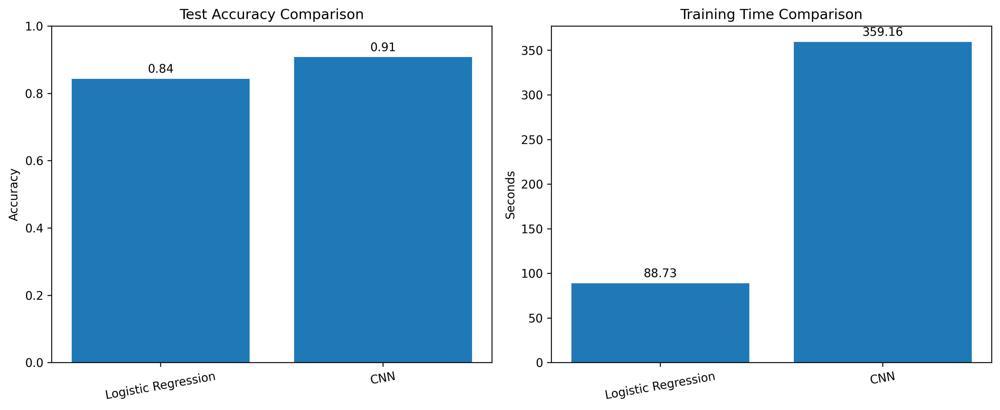
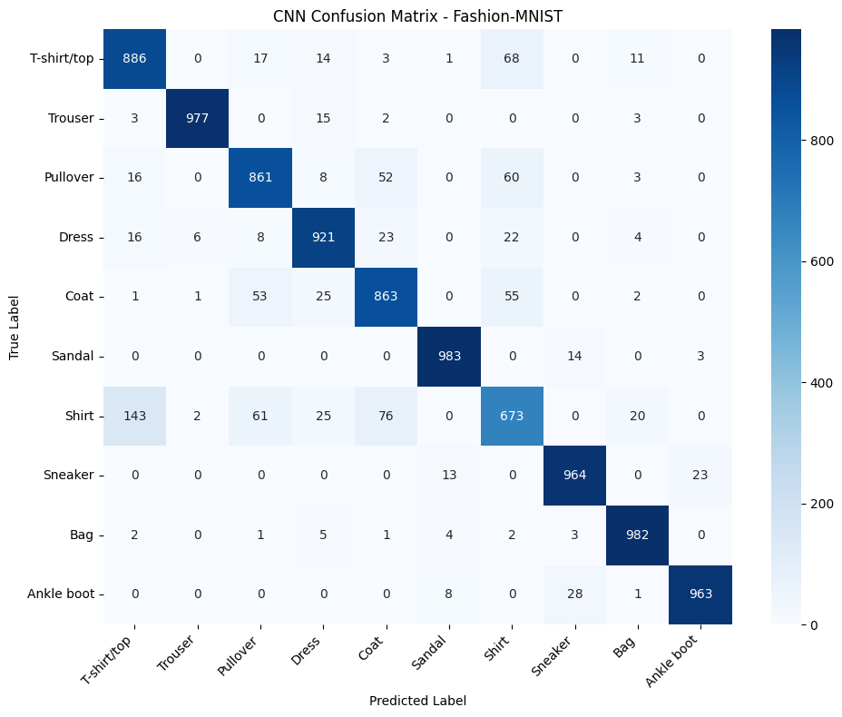

# Fashion-MNIST Image Classification

A deep learning project for classifying clothing images from the Fashion-MNIST dataset using **Logistic Regression** and a **Convolutional Neural Network (CNN)**.  
The project covers **data exploration, preprocessing, model training, evaluation, and performance comparison**.

## Project Overview

Fashion-MNIST is a dataset of **70,000 grayscale clothing images** across **10 categories**, where each image has a resolution of **28 × 28 pixels**.

- **Training set:** 60,000 images
- **Test set:** 10,000 images
- **Number of classes:** 10

## Dataset Classes

The dataset includes the following classes:

- T-shirt/top
- Trouser
- Pullover
- Dress
- Coat
- Sandal
- Shirt
- Sneaker
- Bag
- Ankle boot

## Models

### Logistic Regression
A baseline machine learning model used for comparison.

- Images were flattened into **784 features**
- **Test Accuracy:** 84.31%
- **Training Time:** 88.73 seconds

### Convolutional Neural Network (CNN)
A deep learning model designed to capture image patterns more effectively.

- Includes convolution, max pooling, dense, and dropout layers
- **Test Accuracy:** 90.73%
- **Training Time:** 359.16 seconds

## Results

| Model | Test Accuracy | Training Time |
|------|---------------|---------------|
| Logistic Regression | 84.31% | 88.73 seconds |
| CNN | 90.73% | 359.16 seconds |

The CNN achieved higher classification accuracy than Logistic Regression, showing stronger performance on image classification tasks, although it required more training time.

## Model Comparison

## CNN Confusion Matrix

The confusion matrix shows the CNN's classification performance across the 10 Fashion-MNIST classes.  
Correct predictions appear along the diagonal, while off-diagonal values show misclassifications.

The model performed especially well on **Trouser, Sandal, Bag, and Sneaker**, while **Shirt** was the most challenging class and was sometimes confused with visually similar categories such as **T-shirt/top, Pullover, and Coat**.

## Key Findings

- CNN outperformed Logistic Regression in test accuracy.
- Visually similar clothing categories were harder to classify.
- **Shirt** was the most difficult class for the CNN.
- The confusion matrix helped identify common classification errors.

## Technologies Used

- Python
- TensorFlow / Keras
- Scikit-learn
- NumPy
- Pandas
- Matplotlib
- Seaborn
- Google Colab

## Repository Contents

- `fashion_mnist_deep_learning.ipynb` — Main notebook containing preprocessing, training, and evaluation
- `fashion_mnist_cnn.keras` — Saved trained CNN model
- `model_comparison.csv` — Model performance results
- `model_comparison.png` — Accuracy and training time comparison chart
- `cnn-confusion-matrix.png` — CNN confusion matrix
- `class_names.json` — Class labels used in the project

## Google Colab Notebook

You can explore the full notebook here:

[Open in Google Colab](https://colab.research.google.com/drive/1UOb0S2dyF9T_mSoJr1vCIsCbMDonoXyN?usp=sharing)

## How to Explore

1. Open the notebook in Google Colab.
2. Review the data exploration and preprocessing steps.
3. Compare the Logistic Regression and CNN models.
4. Check the saved model results and visualizations.
5. Use the confusion matrix and comparison chart to understand model performance.

## Future Improvements

- Improve classification of visually similar clothing classes
- Experiment with deeper CNN architectures
- Tune hyperparameters for better performance
- Add prediction on custom images
- Build a simple interface for testing the trained model

## Author

Developed as part of a deep learning and image classification project using the Fashion-MNIST dataset.
